# 🏛️ ICIT Evaluation Framework & Certification Architecture

**Document Identifier:** `ICIT-EXAM-SPEC-V1`  
**Execution Enforcement Engine:** ICIT Phase 3 Autonomous Scoring Engine (`evaluate_p3_matrix.py`)

---

## 🔮 Core Operating Philosophy

The evaluation architecture of this platform enforces the **Law of Complementary Reciprocity**. Every individual submission, algorithm design, and collaborative execution weight parameter is evaluated against a strict mathematical conservation baseline:

$$\sum_{n=1}^{k} \left[ D_i(n) + I_i(C_k - n) \right] \rightarrow C_k^k \quad \forall z \in \mathbb{R}$$

*   **$D_i(n)$** — Deductive Intellect Knowledge *(Left-Brain / Technical Vector Score $[0-10]$)*
*   **$I_i(C_k - n)$** — Inductive Intuitive Knowingness *(Top-Basin / Coherence Vector Score $[0-10]$)*
*   **$C_k$** — Dynamically rolling Polymorphic Conservation Target assigned uniquely per testing sandbox instance.

To mitigate AI-written code and left-brain "grinding" hacks, a candidate must prove complete **Cohesion** across both technical vectors and the 3-Gate P3 Human Capital Matrix, achieving an absolute score threshold of **Total Calibration $\ge$ 85.0% (17/20).** to unlock automated entry into the Enterprise Procurement Registry.

---

## 📊 The 4×3 Certification & Evaluation Matrix

```mermaid
graph TD
%% 1. Structural Connections (Ordered T1 -> T4 Left to Right)
ICIT --> T1[Track 1: Infrastructure <br> C-ISA]
ICIT --> T2[Track 2: Math Kernel <br> C-SME]
ICIT --> T3[Track 3: Crypto & Cyber Specialist <br> C-CCS]
ICIT --> T4[Track 4: Perimeter Defence <br> C-TSD]

%% Track 1 Evaluation Domains (Infrastructure)
T1 --> T1_A["Domain A: Architecture<br><b>C-ISA (Arch)</b><br>Infrastructure Systems Architecture"]
T1 --> T1_O["Domain B: Optimization<br><b>C-ISA (Opt)</b><br>Core Compute & Pipeline Latency"]
T1 --> T1_R["Domain C: Resilience<br><b>C-ISA (Res)</b><br>Fault-Tolerance & Failover Containment"]

%% Track 2 Evaluation Domains (Math Kernel)
T2 --> T2_A["Domain A: Architecture<br><b>C-SME (Arch)</b><br>Sovereign Math Kernel Design"]
T2 --> T2_O["Domain B: Optimization<br><b>C-SME (Opt)</b><br>Deterministic Algorithmic Rigour"]
T2 --> T2_R["Domain C: Resilience<br><b>C-SME (Res)</b><br>Mathematical Stability & Proof Invariance"]

%% Track 3 Evaluation Domains (Crypto & Cyber Specialist)
T3 --> T3_A["Domain A: Architecture<br><b>C-CCS (Arch)</b><br>Post-Quantum & Zero-Knowledge Design"]
T3 --> T3_O["Domain B: Optimization<br><b>C-CCS (Opt)</b><br>Cryptographic Latency & Key Lifecycle"]
T3 --> T3_R["Domain C: Resilience<br><b>C-CCS (Res)</b><br>Adversarial Payload Containment"]

%% Track 4 Evaluation Domains (Perimeter Defence)
T4 --> T4_A["Domain A: Architecture<br><b>C-TSD (Arch)</b><br>Tactical Sovereign Defence Topology"]
T4 --> T4_O["Domain B: Optimization<br><b>C-TSD (Opt)</b><br>Zero-Trust Telemetry & Speed"]
T4 --> T4_R["Domain C: Resilience<br><b>C-TSD (Res)</b><br>Perimeter Isolation & Incident Consensus"]

%% 2. Style Classes Declarations
classDef parent fill:#111,stroke:#333,stroke-width:2px,color:#fff,font-weight:bold;
classDef tier1 fill:#1f2937,stroke:#4b5563,stroke-width:2px,color:#f3f4f6;
classDef tier2 fill:#1e3a8a,stroke:#3b82f6,stroke-width:2px,color:#eff6ff;
classDef tier3 fill:#311042,stroke:#a855f7,stroke-width:2px,color:#faf5ff;
classDef tier4 fill:#064e3b,stroke:#10b981,stroke-width:2px,color:#ecfdf5;
classDef track fill:#0f172a,stroke:#334155,stroke-width:1px,color:#cbd5e1;

%% 3. Apply Styles to Specific Nodes
class IGI parent;
class T1 tier1;
class T2 tier2;
class T3 tier3;
class T4 tier4;
class T1_A,T1_O,T1_R,T2_A,T2_O,T2_R,T3_A,T3_O,T3_R,T4_A,T4_O,T4_R track;

```

## ⚖️ Universal P3 Evaluation Criteria
*Regardless of track, every tier requires simultaneous multi-dimensional assessment against the P3 Matrix to ensure technical mastery scales identically with human-capital alignment.*

### 🚪 Gate I: The Execution Metric
*   **Predictability:** Evaluates live algorithmic execution speed and output variance over continuous test cycles. Frantic, AI-copied hacking spikes telemetry volatility, while top-basin flow models generate calm predictability.
*   **Performance:** Assesses micro-execution throughput and memory footprints under structural stress parameters.
*   **Productivity:** Quantifies sustained structural code clarity during sandbox compilation sprints.

### 🚪 Gate II: The Structural Anchor Metric
*   **Patience:** The capacity to let collaborative code structures mature without injecting forced, volatile over-optimization.
*   **Perseverance:** The cognitive stamina to trace, map, and cleanly neutralize asynchronous race conditions or synchronization anomalies.
*   **Persistence:** An unwavering commitment to absolute data invariants, refusing to cut corners or compromise safety parameters under tight delivery pressures.

### 🚪 Gate III: The Alignment & Integration Metric
*   **Personality:** Validates team architectural synergy and cohesive logic flow within distributed sandbox nodes.
*   **Perspective:** Evaluates macro-system vision—the capacity to prioritize environmental safety, structural containment, and minimalist architectures over unstable throughput features.
*   **Passion:** An intrinsic commitment to algorithmic cohesion laws, treating human-serving technology paradigms as non-negotiable architectural anchors.
